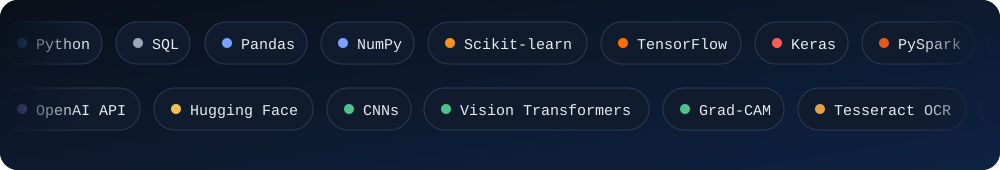

 

 

## Hi, I'm Victor 👋

I'm an AI engineer in the making, based in London and studying for my MSc at the University of East London. I trained as an electrical and electronic engineer and spent my first years at work keeping a company's computers, networks and paperwork running. I kept noticing the same thing: people lose hours to tasks a good system could do in seconds, and the best systems are the ones people can trust.

That is what pulled me into AI. I'm fascinated by models that can explain themselves, that show you *why* they decided something and not only *what* they decided. It's why I built a malaria detector that draws a heatmap of what the model looked at, and why my dissertation checks supply chain paperwork and tells you honestly where it gets things wrong.

I like building with other people. Right now I'm on a placement with a team of four students building an AI voice agent, and I volunteer on a wellbeing app, which taught me to care about the person on the other end of the technology. Away from the screen you'll find me playing football or writing about what I'm learning on Medium.

## How I got here

## What I'm into

- **AI you can trust:** explainable models and honest evaluation, where the weak result gets reported too
- **AI where it matters:** healthcare and other places where a wrong answer has a cost
- **Turning messy documents into answers:** retrieval, OCR and document checking
- **Learning out loud:** sharing what I figure out, including what went wrong

## Things I've built

<table>
<tr>
<td width="33%" valign="top">
<h3>Document checker</h3>
My MSc dissertation. It reads purchase orders, invoices and delivery notes and shows exactly where they disagree.  
<a href="https://github.com/Robinson7070/agentic-rag-supply-chain-dissertation">Code</a> · <a href="https://doi.org/10.5281/zenodo.23473886">Paper</a>
</td>
<td width="33%" valign="top">
<h3>Malaria detector</h3>
A model that spots malaria in cell images and shows a heatmap of why, so a person can check its thinking.  
<a href="https://github.com/Robinson7070/malaria-cell-classification-deep-learning">Code</a> · <a href="https://github.com/Robinson7070/malaria-detection-api">API</a>
</td>
<td width="33%" valign="top">
<h3>doc-compare</h3>
My side project in progress: a tool that checks paperwork, even from scans and photos, and says so when it isn't sure.  
<a href="https://github.com/Robinson7070/doc-compare">Code</a>
</td>
</tr>
</table>

## Tools I use

## Let's connect

I'm looking for my first ML and AI engineer role in the UK, and I'm always happy to talk about AI, a project, or football. The easiest way to reach me is [LinkedIn](https://www.linkedin.com/in/robinson-victor).

