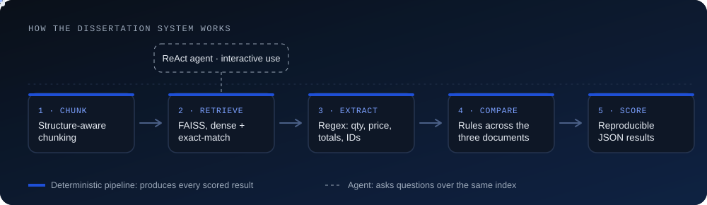

 

 

## About me

I am an MSc AI and Data Science student at the University of East London. I come from Nigeria, trained as an electrical and electronic engineer, worked in IT, then moved into machine learning. Engineering taught me to ask how a thing fails before I trust it, and I bring that to every model I build.

What I care about is systems that can be checked: a test set built before the system, a hold-out I do not tune against, and the weak number reported next to the strong one. Long term I want to build products that businesses use and pay for.

Outside work I play football and write technical articles on Medium.

## My path

## Currently

- **AI/ML placement at Mobex UK:** building the retrieval layer of an AI voice agent, in a team of four students.
- **[doc-compare](https://github.com/Robinson7070/doc-compare):** checks a purchase order, an invoice and a delivery note against each other, from PDFs, scans and photos.

## Flagship: agentic RAG for supply chain documents

My MSc dissertation. It flags mismatches across purchase orders, invoices and delivery notes. A deterministic pipeline produces every scored result, so runs are reproducible, and an agent answers questions on top. [Code](https://github.com/Robinson7070/agentic-rag-supply-chain-dissertation) · [DOI 10.5281/zenodo.23473886](https://doi.org/10.5281/zenodo.23473886)

The weak result is the useful one. Recall fell to 0.57 on the harder corpus because of regex field extraction, and a single-hop baseline comparison on 6 cases (6/6 vs 4/6) gave p = 0.50, which is too few cases to claim a difference.

## More projects

<table>
<tr>
<td width="50%" valign="top">
<h3>doc-compare</h3>
Rule-based three-way document checker. Quotes the exact lines that disagree. If a read looks unreliable it says "needs review" instead of guessing.  
<b>Result:</b> 8/8 development sets. <b>Limit:</b> weak on poor phone photos; hold-out not run yet.  
<a href="https://github.com/Robinson7070/doc-compare">Code</a>
</td>
<td width="50%" valign="top">
<h3>Malaria cell classification</h3>
Custom CNN vs EfficientNetB3 vs Vision Transformer on 27,558 images, with Grad-CAM and Attention Rollout.  
<b>Result:</b> CNN 96.52% accuracy, 97.68% recall.  
<a href="https://github.com/Robinson7070/malaria-cell-classification-deep-learning">Code</a>
</td>
</tr>
<tr>
<td width="50%" valign="top">
<h3>Malaria detection API</h3>
FastAPI service that returns a prediction, a confidence score and a Grad-CAM heatmap for each image.  
<b>Result:</b> an explainable model behind a working REST endpoint.  
<a href="https://github.com/Robinson7070/malaria-detection-api">Code</a>
</td>
<td width="50%" valign="top">
<h3>Also</h3>
<a href="https://github.com/Robinson7070/pdf-rag-chatbot">pdf-rag-chatbot</a>: ask questions about any PDF with LangChain, OpenAI and FAISS.  
<a href="https://github.com/Robinson7070/distributed-ml-pyspark">distributed-ml-pyspark</a>: 8 algorithms on datasets up to 1M rows.
</td>
</tr>
</table>

## Tools

## Say hello

Open to ML and AI engineer roles in the UK. The best way to reach me is [LinkedIn](https://www.linkedin.com/in/robinson-victor).

