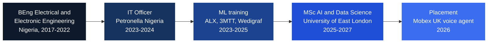

<div align="center">


<br>

<a href="PORTFOLIO_LINK"></a>
<a href="https://www.linkedin.com/in/robinson-victor"></a>
<a href="https://doi.org/10.5281/zenodo.23473886"></a>


</div>

<br>

<table align="center">
<tr>
<td align="center" width="25%"><h2>20 / 20</h2>synthetic sets classified correctly</td>
<td align="center" width="25%"><h2>0.57</h2>recall on the harder 100 sets</td>
<td align="center" width="25%"><h2>96.52%</h2>malaria cell classifier accuracy</td>
<td align="center" width="25%"><h2>8 / 8</h2>doc-compare dev sets, scans included</td>
</tr>
</table>

## About me

I am an MSc AI and Data Science student at the University of East London. I come from Nigeria, trained as an electrical and electronic engineer, worked in IT, then moved into machine learning. Engineering taught me to ask how a thing fails before I trust it, and I bring that to every model I build.

What I care about is systems that can be checked: a test set built before the system, a hold-out I do not tune against, and the weak number reported next to the strong one. Long term I want to build products that businesses use and pay for.

Outside work I play football and write technical articles on Medium.

```text
whoami      Victor Chukwudi Robinson
location    London, UK (from Nigeria)
studying    MSc AI and Data Science, UEL, finishing May 2027
building    retrieval layer for a voice agent (Mobex UK), doc-compare
learning    evaluating RAG systems, reading text from messy documents
ask me      explainable models, document checking, honest evaluation
```

## My path



## Currently

- **AI/ML placement at Mobex UK:** building the retrieval layer of an AI voice agent, in a team of four students.
- **[doc-compare](https://github.com/Robinson7070/doc-compare):** checks a purchase order, an invoice and a delivery note against each other, from PDFs, scans and photos.

## Projects

<table>
<tr>
<td width="50%" valign="top">
<h3>Agentic RAG for supply chain documents</h3>
MSc dissertation. Flags mismatches across purchase orders, invoices and delivery notes. A deterministic pipeline gives reproducible scores, and an agent answers questions on top.<br><br>
<b>Result:</b> 20/20 sets correct. <b>Limit:</b> recall 0.57 on 100 sets.<br><br>
<a href="https://github.com/Robinson7070/agentic-rag-supply-chain-dissertation">Code</a> · <a href="https://doi.org/10.5281/zenodo.23473886">DOI</a>
</td>
<td width="50%" valign="top">
<h3>doc-compare</h3>
Rule-based three-way document checker. Quotes the exact lines that disagree. If a read looks unreliable it says "needs review" instead of guessing.<br><br>
<b>Result:</b> 8/8 development sets. <b>Limit:</b> weak on poor phone photos; hold-out not run yet.<br><br>
<a href="https://github.com/Robinson7070/doc-compare">Code</a>
</td>
</tr>
<tr>
<td width="50%" valign="top">
<h3>Malaria cell classification</h3>
Custom CNN vs EfficientNetB3 vs Vision Transformer on 27,558 images, with Grad-CAM and Attention Rollout.<br><br>
<b>Result:</b> CNN 96.52% accuracy, 97.68% recall.<br><br>
<a href="https://github.com/Robinson7070/malaria-cell-classification-deep-learning">Code</a>
</td>
<td width="50%" valign="top">
<h3>Malaria detection API</h3>
FastAPI service that returns a prediction, a confidence score and a Grad-CAM heatmap for each image.<br><br>
<b>Result:</b> an explainable model behind a working REST endpoint.<br><br>
<a href="https://github.com/Robinson7070/malaria-detection-api">Code</a>
</td>
</tr>
</table>

More: [pdf-rag-chatbot](https://github.com/Robinson7070/pdf-rag-chatbot) (ask questions about any PDF) · [distributed-ml-pyspark](https://github.com/Robinson7070/distributed-ml-pyspark) (8 algorithms, up to 1M rows)

## Skills

**Languages and data**<br>
   

**Machine learning**<br>
   

**LLM and retrieval**<br>
   

**Vision and OCR**<br>
   

**Engineering**<br>
  

## Say hello

Open to ML and AI engineer roles in the UK. The best way to reach me is [LinkedIn](https://www.linkedin.com/in/robinson-victor).


