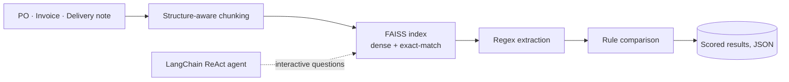

<h1 align="center">Victor Chukwudi Robinson</h1>

  <b>ML and AI engineer · London, UK</b> 
  MSc AI and Data Science, University of East London 
  I build retrieval, vision and document-checking systems, and I report how they perform, including where they fail.

  <a href="PORTFOLIO_LINK">Portfolio</a> ·
  <a href="https://www.linkedin.com/in/robinson-victor">LinkedIn</a> ·
  <a href="https://doi.org/10.5281/zenodo.23473886">Dissertation (DOI)</a>

---

## What I'm working on now

| | |
|---|---|
| **AI/ML placement, Mobex UK** | Developing the retrieval layer of an AI voice agent for inbound business calls, in a team of four students led by Dr Amin Karami. |
| **[doc-compare](https://github.com/Robinson7070/doc-compare)** | An open project that checks a purchase order, an invoice and a delivery note against each other and quotes the exact lines that disagree. Built test-first, with a hold-out set I have not looked at yet. |

## Selected work

### Agentic RAG for supply chain document checking (MSc dissertation)
[Code](https://github.com/Robinson7070/agentic-rag-supply-chain-dissertation) · [DOI 10.5281/zenodo.23473886](https://doi.org/10.5281/zenodo.23473886)

A system that compares purchase orders, invoices and delivery notes and flags mismatches. A deterministic pipeline produces every scored result, so runs are reproducible. A LangChain ReAct agent sits on top for interactive questions.

| What worked | What did not |
|---|---|
| 20 of 20 synthetic sets classified correctly, 0 false positives, 0 false negatives. | Recall fell to **0.57** on a harder 100-set corpus, traced to regex field extraction. |
| Defined a custom **Hop Completeness** metric (0.975) for multi-document reasoning. | A single-hop baseline comparison on 6 cases (6/6 vs 4/6) gave p = 0.50: too few cases to claim a difference. |
| Wilson 95% interval reported for the 20-set result: [0.80, 1.00]. | Cross-set retrieval contamination matched one purchase order to a delivery note from another set. |

### doc-compare (in progress)
[Code](https://github.com/Robinson7070/doc-compare)

Rule-based three-way document checker in Python. Reads PDFs, scans and phone photos (OCR with Tesseract), and **refuses to guess**: if a document's line totals do not add up to its printed subtotal, it reports "needs review" instead of inventing findings.

- 8 of 8 development sets correct, including a scanned set. Two hold-out sets still unseen.
- Known weakness: poor phone photos of screens. The tool flags those for review rather than answering wrongly.

### Malaria cell classification
[Code](https://github.com/Robinson7070/malaria-cell-classification-deep-learning)

Compared a custom CNN, EfficientNetB3 and a Vision Transformer on 27,558 cell images. The CNN reached **96.52% accuracy and 97.68% recall**. Grad-CAM and Attention Rollout show what each model looked at.

### Malaria detection API
[Code](https://github.com/Robinson7070/malaria-detection-api)

A FastAPI service that returns a prediction, a confidence score and a Grad-CAM heatmap for each uploaded image, so a reviewer can see why the model answered as it did.

### Also
- [pdf-rag-chatbot](https://github.com/Robinson7070/pdf-rag-chatbot): ask questions about any PDF using LangChain, OpenAI and FAISS
- [distributed-ml-pyspark](https://github.com/Robinson7070/distributed-ml-pyspark): eight PySpark MLlib exercises across regression, classification, NLP and time series, up to 1M rows

## Tools

`Python` `SQL` `Pandas` `NumPy` `Scikit-learn` `TensorFlow` `Keras` `LangChain` `FAISS` `FastAPI` `PySpark` `Tesseract OCR` `Grad-CAM`

## How I work

- I build the test set before the system, and keep a hold-out set I do not tune against.
- I report the weak number next to the strong one.
- I tag the exact version that produced each result.

Open to ML and AI engineer roles in the UK. The best way to reach me is [LinkedIn](https://www.linkedin.com/in/robinson-victor).
